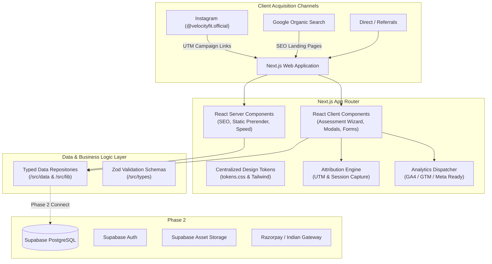

# Velocity Fit — Technical Architecture

## 1. Architectural Philosophy
The Velocity Fit platform is engineered around three non-negotiable architectural axioms:
1. **Conversion Velocity & Core Web Vitals:** Sub-second LCP (Largest Contentful Paint), zero CLS (Cumulative Layout Shift), and minimal client-side JavaScript execution via Next.js React Server Components (RSC).
2. **Decoupled Future-Proof Data Layer:** All business entities (programs, leads, testimonials, FAQs) are accessed through typed abstract data repositories. In Phase 1, data is served from typed in-memory stores; in Phase 2, this effortlessly points to Supabase PostgreSQL without refactoring UI components.
3. **Non-Technical Maintainability:** Built with declarative components and centralized design tokens so non-technical stakeholders (e.g., Dr. Lubna Fatima) can eventually update programs, FAQs, and lead statuses via a visual administrative interface.

---

## 2. System Architecture Diagram



---

## 3. Directory Conventions & Codebase Structure

```
velocity-fit-reimagined/
├── .lovable/                    # Lovable connection & project metadata
├── docs/                        # Complete product & engineering documentation
│   ├── PROJECT-OVERVIEW.md
│   ├── ARCHITECTURE.md
│   ├── PRODUCT-ROADMAP.md
│   ├── DESIGN-SYSTEM.md
│   ├── LEAD-GENERATION.md
│   ├── SEO-STRATEGY.md
│   ├── DATA-MODEL.md
│   ├── ADMIN-PLAN.md
│   └── DECISIONS.md
├── public/                      # Static assets, logos, favicon, og-images
│   └── images/
├── src/
│   ├── app/                     # Next.js App Router routes
│   │   ├── (marketing)/         # Marketing routes sharing primary shell
│   │   │   ├── page.tsx         # Conversion-focused homepage
│   │   │   ├── about/           # Founder & clinical philosophy
│   │   │   ├── programs/        # Program catalog & dynamic [slug]
│   │   │   │   └── [slug]/
│   │   │   ├── how-it-works/    # 4-stage formula & V6 Audit™
│   │   │   ├── results/         # Transformations & clinical case studies
│   │   │   ├── faq/             # Categorized FAQs
│   │   │   ├── resources/       # Guides & articles
│   │   │   │   └── [slug]/
│   │   │   ├── contact/         # Official Hyderabad contact & enquiry
│   │   │   └── get-started/     # Multi-step health assessment wizard
│   │   ├── admin/               # Authenticated Clinical CRM & Management
│   │   │   ├── login/           # Admin staff sign-in portal
│   │   │   └── (dashboard)/     # Protected dashboard route group
│   │   │       ├── layout.tsx   # Enforces auth check & admin shell
│   │   │       ├── page.tsx     # Dashboard metrics & recent inbound feed
│   │   │       └── leads/       # CRM table & [id] detail viewer
│   │   │           └── [id]/
│   │   ├── api/                 # Secure serverless API endpoints
│   │   │   ├── admin/           # Privileged endpoints (auth, status, notes)
│   │   │   └── leads/           # Public endpoints (contact, assessment)
│   │   ├── layout.tsx           # Root layout with fonts, header, footer
│   │   ├── loading.tsx          # Global loading skeleton
│   │   ├── error.tsx            # Graceful error boundary
│   │   ├── not-found.tsx        # Branded 404 page
│   │   ├── robots.ts            # Dynamic robots.txt
│   │   └── sitemap.ts           # Dynamic XML sitemap
│   ├── middleware.ts            # Edge protection redirecting unauthenticated users from /admin
│   ├── components/
│   │   ├── ui/                  # Accessible design system primitives
│   │   ├── common/              # Global composite components
│   │   ├── cards/               # Business presentation cards
│   │   ├── forms/               # High-conversion interactive forms
│   │   └── admin/               # Administrative CRM UI components
│   ├── data/                    # Typed mock/CMS data stores
│   ├── lib/                     # Core business logic & utility modules
│   │   ├── auth/                # Admin authentication & RBAC helpers
│   │   ├── notifications/       # Provider-agnostic notification service
│   │   ├── security/            # Sliding-window abuse & rate limiter
│   │   ├── supabase/            # Browser, Server, Admin clients & DB gateway
│   │   ├── validations/         # Zod schemas for contact & assessments
│   │   ├── attribution.ts       # UTM parameter & session capture engine
│   │   ├── analytics.ts         # Vendor-agnostic analytics event bus
│   │   ├── seo.ts               # Structured metadata & JSON-LD generators
│   │   └── utils.ts             # Tailwind class merges (cn)
│   ├── styles/                  # Styling & design token definitions
│   └── types/                   # TypeScript interfaces (CRM, leads, programs)
├── supabase/
│   └── migrations/              # PostgreSQL DDL migrations & RLS policies
├── scripts/                     # Automated QA & backend test suites
├── tailwind.config.ts           # Tailwind configuration referencing tokens
├── tsconfig.json                # Strict TypeScript configuration
└── package.json                 # Dependency manifest
```

---

## 4. Server vs. Client Component Boundaries
- **Server Components (Default):** All static layouts, editorial pages (`/about`, `/how-it-works`, `/resources/[slug]`), SEO metadata rendering, programmatic sitemaps, and CRM Server pages (`/admin`, `/admin/leads`, `/admin/leads/[id]`) execute securely on the server.
- **Client Components (`'use client'`):** Restricted strictly to interactive interfaces:
  - `Header`: Mobile hamburger navigation drawer, scroll state detection.
  - `AssessmentWizard`: Multi-step questionnaire state management, Zod validation, API submission.
  - `ContactForm`: Client-side validation, submit state handling, API submission, WhatsApp handoff.
  - `BookingForm`: Interactive IST consultation slot selector, real-time availability sync, meeting type selection.
  - `CheckoutFlow`: Track/tier/duration selector, real-time verified price calculator, Razorpay modal checkout & developer sandbox simulator.
  - `AppointmentManager`: Admin 1-click consultation status updater (`REQUESTED`, `CONFIRMED`, `COMPLETED`, `CANCELLED`, `NO_SHOW`).
  - `Accordion`: Accessible interactive disclosure panels for FAQs.
- **Least-Privilege Secret Management:** No private API keys or database connection strings in client bundles; strictly isolated behind `process.env` in server actions/routes (`RAZORPAY_KEY_SECRET`, `RAZORPAY_WEBHOOK_SECRET`, `SUPABASE_SERVICE_ROLE_KEY`).
- **Server-Enforced Commercial Pricing:** Client-submitted prices are discarded; the server strictly computes order amount from `src/lib/payments/pricing.ts` based on program track, support tier, and duration.
- **Double-Booking Prevention:** Consultation slot availability queries and booking transactions evaluate existing active appointments (`status !== 'CANCELLED'`) in Asia/Kolkata (IST) operating hours (10:00-13:00, 15:00-18:00 Mon-Sat).
- **Cryptographic Payment Integrity:** HMAC-SHA256 signatures are validated on `POST /api/payments/verify` and `POST /api/payments/webhook`. Lead conversion to `CONVERTED` is strictly gated on cryptographic verification; failed/cancelled payments preserve existing lead status.
- **Vercel Edge Security:** Configured with security headers (`Content-Security-Policy`, `X-Frame-Options: DENY`, `X-Content-Type-Options: nosniff`, `Referrer-Policy: strict-origin-when-cross-origin`).
