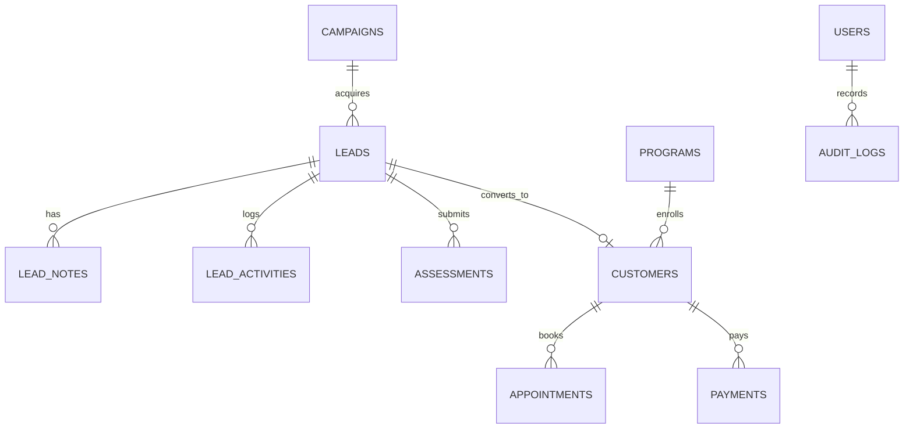

# Velocity Fit — Data Architecture & Schema Specification

## 1. Overview
This document outlines the complete relational data architecture implemented for the Velocity Fit platform. In Phase 2A, the schema is actively deployed via Supabase migration `supabase/migrations/20260906000001_initial_crm_schema.sql`, featuring comprehensive Row Level Security (RLS), triggers for `updated_at`, normalized phone indexing for deduplication, and a dual-mode database gateway (`src/lib/supabase/db.ts`).

---

## 1.1 Implementation Status (Phase 2A Foundation)
- **Active Migration:** `supabase/migrations/20260906000001_initial_crm_schema.sql`
- **Tables Deployed:** `admin_profiles`, `leads`, `lead_status_history`, `lead_notes`, `assessments`, `notifications`, `audit_logs`.
- **Row Level Security (RLS):** Enabled across 100% of tables with helper function `is_admin()`. Public unauthenticated users cannot query or modify CRM records.
- **Deduplication Engine:** Automatically queries incoming phones normalized to standard E.164 (`91XXXXXXXXXX`). Existing leads are updated with new preferences and reactivated to `FOLLOW_UP` without creating duplicate records.
- **Zero Medical Data Leaks:** Strict data boundary preventing clinical assessment fields from ever being stored in audit logs, notifications, URLs, or analytics.

---

## 2. Entity Relationship Diagram



---

## 3. Core Database Tables (PostgreSQL / Supabase)

### 3.1 Leads & CRM Subsystem

```sql
-- 1. Leads Table
CREATE TABLE leads (
    id UUID PRIMARY KEY DEFAULT gen_random_uuid(),
    created_at TIMESTAMPTZ NOT NULL DEFAULT now(),
    updated_at TIMESTAMPTZ NOT NULL DEFAULT now(),
    full_name TEXT NOT NULL,
    phone TEXT NOT NULL,
    email TEXT,
    age INT,
    gender TEXT,
    city TEXT,
    status TEXT NOT NULL DEFAULT 'NEW' CHECK (
        status IN (
            'NEW', 'CONTACTED', 'QUALIFIED', 'FOLLOW_UP',
            'CONSULTATION_BOOKED', 'CONSULTATION_COMPLETED',
            'PAYMENT_PENDING', 'CONVERTED', 'ACTIVE_CUSTOMER',
            'NOT_INTERESTED', 'LOST'
        )
    ),
    preferred_program TEXT,
    preferred_contact_method TEXT DEFAULT 'WHATSAPP',
    utm_source TEXT,
    utm_medium TEXT,
    utm_campaign TEXT,
    utm_content TEXT,
    utm_term TEXT,
    first_landing_page TEXT,
    referrer_url TEXT,
    device_type TEXT,
    assigned_to UUID REFERENCES auth.users(id)
);

-- 2. Lead Notes
CREATE TABLE lead_notes (
    id UUID PRIMARY KEY DEFAULT gen_random_uuid(),
    lead_id UUID NOT NULL REFERENCES leads(id) ON DELETE CASCADE,
    author_id UUID REFERENCES auth.users(id),
    created_at TIMESTAMPTZ NOT NULL DEFAULT now(),
    note_body TEXT NOT NULL
);

-- 3. Lead Activities (Audit trail of calls, WhatsApp messages, status changes)
CREATE TABLE lead_activities (
    id UUID PRIMARY KEY DEFAULT gen_random_uuid(),
    lead_id UUID NOT NULL REFERENCES leads(id) ON DELETE CASCADE,
    created_at TIMESTAMPTZ NOT NULL DEFAULT now(),
    activity_type TEXT NOT NULL, -- 'STATUS_CHANGE', 'WHATSAPP_SENT', 'CALL_LOGGED'
    description TEXT NOT NULL
);
```

### 3.2 Clinical Assessment Subsystem

```sql
-- 4. Health Assessments
CREATE TABLE assessments (
    id UUID PRIMARY KEY DEFAULT gen_random_uuid(),
    lead_id UUID REFERENCES leads(id) ON DELETE SET NULL,
    created_at TIMESTAMPTZ NOT NULL DEFAULT now(),
    height_cm NUMERIC(5,2) NOT NULL,
    current_weight_kg NUMERIC(5,2) NOT NULL,
    highest_weight_kg NUMERIC(5,2),
    target_weight_kg NUMERIC(5,2) NOT NULL,
    target_timeframe TEXT NOT NULL, -- '1 Months', '2 Months', '3 Months', '6 Months'
    primary_goals TEXT[] NOT NULL,
    medical_conditions TEXT[] NOT NULL,
    medications TEXT,
    surgeries TEXT,
    female_markers TEXT[],
    water_intake_liters NUMERIC(4,2) NOT NULL,
    sleep_hours NUMERIC(4,2) NOT NULL,
    bowel_movement TEXT,
    eating_patterns TEXT[] NOT NULL,
    diet_struggles TEXT,
    commitment_score INT CHECK (commitment_score BETWEEN 1 AND 10),
    ready_for_60_days BOOLEAN NOT NULL DEFAULT true,
    acquisition_channel TEXT
);
```

### 3.3 Programs & Commercial Subsystem

```sql
-- 5. Programs
CREATE TABLE programs (
    id UUID PRIMARY KEY DEFAULT gen_random_uuid(),
    slug TEXT UNIQUE NOT NULL,
    title TEXT NOT NULL,
    track TEXT NOT NULL CHECK (track IN ('Flex', 'Grit')),
    tagline TEXT NOT NULL,
    description TEXT NOT NULL,
    features JSONB NOT NULL DEFAULT '[]',
    is_active BOOLEAN NOT NULL DEFAULT true
);

-- 6. Program Pricing Tiers
CREATE TABLE program_pricing_tiers (
    id UUID PRIMARY KEY DEFAULT gen_random_uuid(),
    program_id UUID NOT NULL REFERENCES programs(id) ON DELETE CASCADE,
    tier TEXT NOT NULL CHECK (tier IN ('Prime', 'Elite')),
    duration_months INT NOT NULL CHECK (duration_months IN (1, 3)),
    regular_price_inr INT NOT NULL,
    sale_price_inr INT NOT NULL,
    is_popular BOOLEAN DEFAULT false
);

-- 7. Appointments
CREATE TABLE appointments (
    id UUID PRIMARY KEY DEFAULT gen_random_uuid(),
    lead_id UUID REFERENCES leads(id) ON DELETE CASCADE,
    doctor_id UUID REFERENCES auth.users(id),
    scheduled_at TIMESTAMPTZ NOT NULL,
    duration_minutes INT NOT NULL DEFAULT 30,
    status TEXT NOT NULL DEFAULT 'CONFIRMED' CHECK (status IN ('CONFIRMED', 'COMPLETED', 'CANCELLED', 'RESCHEDULED')),
    meeting_link TEXT,
    notes TEXT
);

-- 8. Payments
CREATE TABLE payments (
    id UUID PRIMARY KEY DEFAULT gen_random_uuid(),
    lead_id UUID REFERENCES leads(id),
    razorpay_order_id TEXT UNIQUE,
    razorpay_payment_id TEXT UNIQUE,
    amount_inr INT NOT NULL,
    currency TEXT NOT NULL DEFAULT 'INR',
    status TEXT NOT NULL DEFAULT 'PENDING' CHECK (status IN ('PENDING', 'SUCCESS', 'FAILED')),
    paid_at TIMESTAMPTZ
);
```

### 3.4 Content Management Subsystem (CMS)

```sql
-- 9. FAQs
CREATE TABLE faqs (
    id UUID PRIMARY KEY DEFAULT gen_random_uuid(),
    category TEXT NOT NULL, -- 'Clinical', 'Programs', 'Diet', 'Logistics'
    question TEXT NOT NULL,
    answer TEXT NOT NULL,
    display_order INT NOT NULL DEFAULT 0,
    is_published BOOLEAN NOT NULL DEFAULT true
);

-- 10. Testimonials & Transformations (Verified Patient Showcase)
CREATE TABLE testimonials (
    id UUID PRIMARY KEY DEFAULT gen_random_uuid(),
    client_name TEXT NOT NULL,
    age INT,
    city TEXT,
    program_enrolled TEXT,
    weight_lost_kg NUMERIC(4,1),
    quote TEXT NOT NULL,
    story_body TEXT,
    before_image_url TEXT,
    after_image_url TEXT,
    is_verified BOOLEAN NOT NULL DEFAULT false, -- Strict client verification flag
    is_featured BOOLEAN NOT NULL DEFAULT false
);

-- 11. Resource / Blog Articles
CREATE TABLE resources (
    id UUID PRIMARY KEY DEFAULT gen_random_uuid(),
    slug TEXT UNIQUE NOT NULL,
    title TEXT NOT NULL,
    excerpt TEXT NOT NULL,
    content_markdown TEXT NOT NULL,
    category TEXT NOT NULL,
    author_name TEXT DEFAULT 'Dr. Lubna Fatima',
    published_at TIMESTAMPTZ DEFAULT now(),
    is_published BOOLEAN DEFAULT true
);
```

---

## 4. Phase 2B Consultation & Payment Subsystems

Active Migration: `supabase/migrations/20260907000001_phase2b_booking_payments.sql`

```sql
-- 12. Appointments Table
CREATE TABLE public.appointments (
    id UUID PRIMARY KEY DEFAULT uuid_generate_v4(),
    lead_id UUID NOT NULL REFERENCES public.leads(id) ON DELETE CASCADE,
    customer_id UUID REFERENCES auth.users(id) ON DELETE SET NULL,
    start_time TIMESTAMPTZ NOT NULL,
    end_time TIMESTAMPTZ NOT NULL,
    timezone TEXT NOT NULL DEFAULT 'Asia/Kolkata',
    status TEXT NOT NULL DEFAULT 'REQUESTED' CHECK (
        status IN ('REQUESTED', 'CONFIRMED', 'COMPLETED', 'CANCELLED', 'NO_SHOW')
    ),
    meeting_type TEXT NOT NULL DEFAULT 'VIDEO_CALL' CHECK (
        meeting_type IN ('VIDEO_CALL', 'PHONE_CALL', 'IN_PERSON')
    ),
    meeting_link TEXT,
    notes TEXT,
    created_at TIMESTAMPTZ NOT NULL DEFAULT now(),
    updated_at TIMESTAMPTZ NOT NULL DEFAULT now()
);

-- 13. Payments Table
CREATE TABLE public.payments (
    id UUID PRIMARY KEY DEFAULT uuid_generate_v4(),
    lead_id UUID NOT NULL REFERENCES public.leads(id) ON DELETE CASCADE,
    customer_id UUID REFERENCES auth.users(id) ON DELETE SET NULL,
    program_track TEXT NOT NULL CHECK (program_track IN ('Flex', 'Grit')),
    support_tier TEXT NOT NULL CHECK (support_tier IN ('Prime', 'Elite')),
    duration TEXT NOT NULL CHECK (duration IN ('1-month', '3-months')),
    amount INT NOT NULL, -- in INR (e.g. 2000, 5500, 3000, 8000)
    currency TEXT NOT NULL DEFAULT 'INR',
    gateway TEXT NOT NULL DEFAULT 'razorpay' CHECK (gateway IN ('razorpay', 'cashfree', 'mock')),
    gateway_order_id TEXT NOT NULL UNIQUE,
    gateway_payment_id TEXT,
    gateway_signature TEXT,
    status TEXT NOT NULL DEFAULT 'CREATED' CHECK (
        status IN ('CREATED', 'PENDING', 'SUCCESS', 'FAILED', 'CANCELLED', 'REFUNDED')
    ),
    metadata JSONB NOT NULL DEFAULT '{}'::jsonb,
    created_at TIMESTAMPTZ NOT NULL DEFAULT now(),
    updated_at TIMESTAMPTZ NOT NULL DEFAULT now()
);

-- 14. Customers Table (Forward preparation for Phase 3 Portal)
CREATE TABLE public.customers (
    id UUID PRIMARY KEY DEFAULT uuid_generate_v4(),
    lead_id UUID REFERENCES public.leads(id) ON DELETE SET NULL,
    email TEXT UNIQUE,
    phone TEXT NOT NULL,
    full_name TEXT NOT NULL,
    created_at TIMESTAMPTZ NOT NULL DEFAULT now(),
    updated_at TIMESTAMPTZ NOT NULL DEFAULT now()
);

-- 15. Program Enrollments Table
CREATE TABLE public.program_enrollments (
    id UUID PRIMARY KEY DEFAULT uuid_generate_v4(),
    customer_id UUID NOT NULL REFERENCES public.customers(id) ON DELETE CASCADE,
    payment_id UUID REFERENCES public.payments(id) ON DELETE SET NULL,
    program_track TEXT NOT NULL,
    support_tier TEXT NOT NULL,
    duration TEXT NOT NULL,
    start_date DATE NOT NULL DEFAULT CURRENT_DATE,
    end_date DATE NOT NULL,
    status TEXT NOT NULL DEFAULT 'ACTIVE' CHECK (status IN ('ACTIVE', 'PAUSED', 'COMPLETED', 'EXPIRED')),
    created_at TIMESTAMPTZ NOT NULL DEFAULT now(),
    updated_at TIMESTAMPTZ NOT NULL DEFAULT now()
);
```

