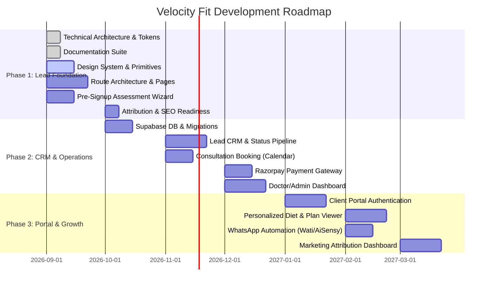

# Velocity Fit — Product Roadmap

This roadmap defines the iterative evolution of the Velocity Fit platform across three distinct phases. The engineering approach ensures that early phases establish the architectural scaffolding required by subsequent phases without incurring technical debt or premature complexity.

---

## Roadmap Overview

---

## Phase 1: Professional Website & Lead Foundation (Current Target)

### Objectives
- Establish an authoritative, conversion-optimized public web presence for Dr. Lubna Fatima and Velocity Fit.
- Replace legacy WordPress installation with a sub-second Next.js application.
- Deploy the interactive **Pre-Signup Health Assessment** to qualify and capture inbound prospective clients.
- Build resilient attribution capture (`utm_*`, referrer, landing page) for all leads.

### Core Deliverables
| Area | Feature / Deliverable | Status |
| :--- | :--- | :--- |
| **Architecture** | Next.js App Router, TypeScript strict, Tailwind CSS, Token system | In Progress |
| **Documentation** | Complete 9-file specification suite in `/docs` | In Progress |
| **Design Tokens** | Deep Charcoal, Champagne Gold, Soft Warm Neutrals palette | In Progress |
| **Routes** | `/`, `/about`, `/programs`, `/programs/[slug]`, `/how-it-works`, `/results`, `/faq`, `/resources`, `/resources/[slug]`, `/contact`, `/get-started` | Phase 1 |
| **Forms** | 5-stage interactive Pre-Signup Assessment Wizard with validation | Phase 1 |
| **Attribution** | Session-persistent UTM & referrer extraction engine | Phase 1 |
| **SEO** | Semantic HTML5, dynamic OpenGraph, Schema.org JSON-LD (Physician, MedicalBusiness) | Phase 1 |

---

## Phase 2: Business Management System / CRM, Booking & Payments

### Phase 2A: CRM & Lead Management Foundation (COMPLETED)
- **Supabase PostgreSQL & Migrations:** Complete DDL deployed with Row-Level Security (RLS) for `admin_profiles`, `leads`, `lead_status_history`, `lead_notes`, `assessments`, `notifications`, and `audit_logs`.
- **Admin Authentication & RBAC:** Edge middleware route protection redirecting unauthenticated visitors to `/admin/login`. Supports Supabase Auth and offline development credentials.
- **Lead Pipeline:** 11 strict business statuses (`NEW`, `CONTACTED`, `QUALIFIED`, `FOLLOW_UP`, `CONSULTATION_BOOKED`, `CONSULTATION_COMPLETED`, `PAYMENT_PENDING`, `CONVERTED`, `ACTIVE_CUSTOMER`, `NOT_INTERESTED`, `LOST`) with full status change history.
- **Deduplication Engine:** Normalizes incoming phone numbers (E.164) to prevent duplicate leads while updating clinical intake history.
- **Protected Clinical Viewer:** Doctor-only view of 5-stage health assessment markers, calculated BMI, and vital habit baselines.
- **1-Click Communications:** Immediate WhatsApp consultation trigger pre-filled with client name and inquiry focus.

### Phase 2B: Consultation Booking & Payments (COMPLETED)
- **Consultation Booking Engine:**
  - Dedicated mobile-first booking interface at `/book-consultation`.
  - Real-time availability API (`GET /api/booking/availability?date=YYYY-MM-DD`) strictly in Asia/Kolkata (IST).
  - Double-booking prevention: Slot collision engine rejects duplicate bookings with HTTP 409 Conflict.
  - Calendar provider abstraction supporting mock development mode, Google Calendar, and Cal.com.
  - Automatic lead status transition to `CONSULTATION_BOOKED`.
- **Payment & Enrollment Foundation:**
  - Secure checkout experience at `/checkout` with interactive track/tier/duration selector.
  - Single source of truth server pricing (`src/lib/payments/pricing.ts`) strictly enforcing verified WooCommerce rates (Prime: ₹2,000/₹5,500, Elite: ₹3,000/₹8,000). Browser price overrides are completely ignored.
  - Razorpay order creation (`POST /api/payments/create-order`) and cryptographic HMAC-SHA256 signature verification (`POST /api/payments/verify`).
  - Idempotent webhook handler (`POST /api/payments/webhook`) and cancellation endpoint (`POST /api/payments/cancel`).
  - Gated conversion engine: Leads transition to `PAYMENT_PENDING` on checkout initiation, and to `CONVERTED` **only** upon cryptographic payment verification. Failed/cancelled transactions do not convert leads.
- **Admin Workspace Integration:**
  - 1-click consultation status management (`REQUESTED`, `CONFIRMED`, `COMPLETED`, `CANCELLED`, `NO_SHOW`) on `/admin/leads/[id]`. Completing a consultation automatically transitions lead to `CONSULTATION_COMPLETED`.
  - Live payment & enrollment transaction viewer displaying gateway order ID, payment ID, amount, and status badge.

---

## Phase 3: Client Portal, Automation & Growth Analytics

### Objectives
- Deliver a high-retention post-purchase digital experience for active coaching clients.
- Automate reminders and lifestyle tracking (water intake, weekly weight updates).
- Give the business owner actionable intelligence on ad spend vs. revenue.

### Core Deliverables
1. **Client Experience Portal:**
   - Secure phone OTP / magic link login via Supabase Auth.
   - Personalized diet chart viewer and meal plan instructions.
   - Weekly measurement & photo check-in submission form.
2. **Omnichannel Messaging Automation:**
   - WhatsApp API integration (via official Meta Cloud API or Wati/Interakt).
   - Automated check-in reminders and milestone celebrations.
3. **Advanced Marketing Analytics:**
   - Closed-loop revenue attribution: Track which Instagram campaign or Google keyword generated actual paid transformations.
   - Client retention and renewal forecasting dashboard.
